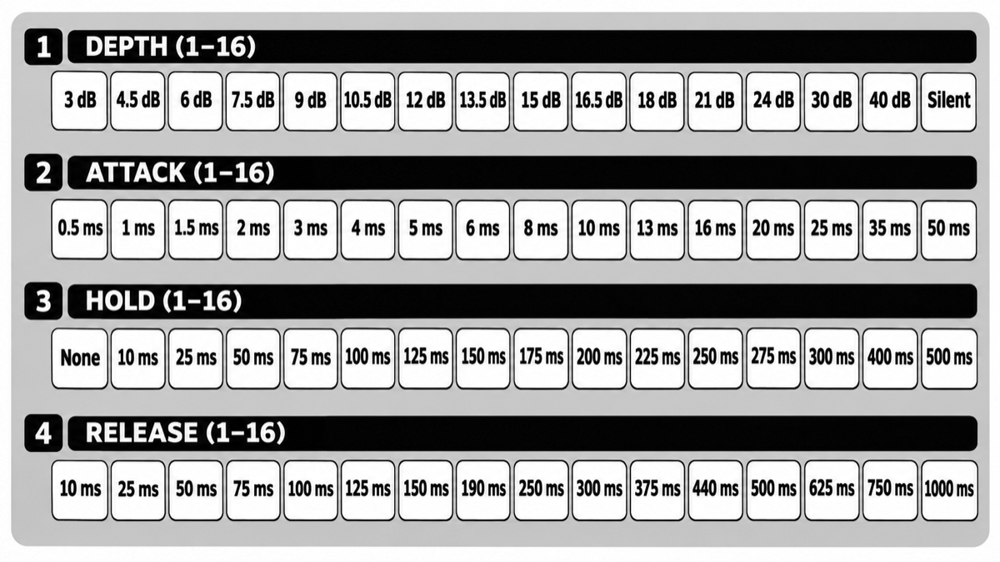

# FX SIDECHAIN USER GUIDE

**FX SIDECHAIN** brings sidechain pumping to the Pērkons. One voice is the master: each time it
plays, the other three voices duck and swell back, the pumping sound of a sidechain
compressor keyed from the kick.

* **Any voice can be the master**: usually the kick, but any voice can drive the pump.
* **Depth, attack, hold and release** are set on the four rows of step buttons, from a gentle
  pump to a hard chop.
* **Made for performance**: the ranges are aimed at pumping and chopping, not subtle mixing.
* **On and off from any page** with KIT + SYNC, for drops and build-ups.
* **Saved with the kit**: each kit keeps its own sidechain.

Based on official Pērkons firmware **1.3.0**. Unofficial; not affiliated with Erica Synths.

## Getting it

The easiest way is the [Perkons Mod Matrix Desktop](https://github.com/remixed123/modmatrix-desktop#mod-matrix-desktop)
app for macOS and Windows: nothing else to install. Load your own official firmware 1.3.0,
tick **FX SIDECHAIN** and press **PATCH IT**. You can also run the Mod Matrix from perkons-re: follow
[Get modded firmware](https://github.com/kiteless/perkons-re#get-modded-firmware). No
firmware files are provided here. To remove it, flash the official
firmware again.

FX SIDECHAIN works with the factory voices and with every voice engine (KICK LAB, SYNTH LAB,
AKORDS and the others).

## Controls

| control | what it does |
|---|---|
| **KIT + SYNC** (tap) | Hold **KIT** and tap **SYNC** to turn the sidechain on or off, from any page. The change is saved with the kit at once. Releasing KIT leaves you on the kit page, as usual |
| **KIT + SYNC** (hold) | Hold **KIT** and hold **SYNC** for half a second to open the [sidechain page](#the-sidechain-page). It stays open after you let go |

## The sidechain page

To open it, hold **KIT** and hold **SYNC** for half a second, from any page.

| on the page | what it does |
|---|---|
| **Row 1: depth** | How far the other voices dip, from 3 dB to 40 dB. Most of the row is between 6 and 18 dB, where the pumping happens. The deep steps give a harder chop, and **Silent** (step 16) cuts the voices out completely |
| **Row 2: attack** | How fast the voices dip when the master plays, from 0.5 ms to 50 ms. Short attacks get out of the kick's way at once; longer ones soften the duck into a swell |
| **Row 3: hold** | How long the voices stay down before they come back, from none to 500 ms. The steps are 25 ms apart from 100 to 300 ms, where most pumping happens |
| **Row 4: release** | How long the voices take to come back to normal, from 10 ms to 1 s. For the classic pump, make hold plus release just under one beat: 150 ms hold and 300 ms release at 120-130 BPM |
| **Trigger keys 1-4** | Choose the master voice: its trigger key stays lit. The voice also plays as usual, so you hear the duck at once |
| **SYNC** | Turns the sidechain on or off. Its LED is lit while it's on |
| **SHIFT**, **KIT**, **MOD** or any page button | Leaves the page |

On each row the bright step is the one chosen, with a dim bar up to it. Everything is dimmer
while the sidechain is off. See the image below for every step's value.

The voices keep playing while the page is open, so you can hear every change.

## How it behaves

* **Every master trigger ducks**: sequencer steps, its trigger key and MIDI notes.
* **The other three voices duck together.** The master itself is never ducked.
* **It's heard everywhere**: the duck happens inside the voices, before the outputs, so it's
  on the individual voice outputs, the main mix and the FX send. Echo and reverb tails
  already in the FX don't duck.
* **No clicks**: a new master trigger during a duck starts again from wherever the level is.
* Turning the sidechain off, or choosing another master, lets a duck under way finish its
  release.
* While the sidechain is off, the voices sound exactly as without the mod.

## Saving

Each kit keeps its own sidechain: on or off, the master, and the four rows. They're saved in
the kit's companion file on the card, so the kit files themselves stay unchanged.

* An on or off with KIT + SYNC is saved at once.
* Changes on the sidechain page are saved when you leave the page.
* Saving a kit as usual saves the sidechain it's playing with.
* Loading a kit or a bank brings back each kit's sidechain.

A kit saved before FX SIDECHAIN was installed starts with the sidechain off, voice 1 as the
master, 15 dB depth, 1 ms attack, 150 ms hold and 300 ms release: switch it on and it pumps.

## MIDI and the sequencer

* MIDI notes for the master voice duck the others, as its steps do.
* The sidechain has no MIDI CCs or parameter locks: it's set on its page and saved with the
  kit.

## Tips

* **Classic pump**: the kick as master on every beat, at 120-130 BPM, with the settings a new
  kit starts with. Turn it on with KIT + SYNC for the drop.
* **Hard chop**: depth Silent, attack 0.5 ms, hold 100 to 200 ms, release 10 or 25 ms. Pads
  and chords are cut in time with the master.
* **Stutter**: the same hard chop, with the master on every sixteenth.
* **Slow swell**: depth 24 dB, hold 250 ms, release 750 or 1000 ms, under a half-time kick.
* **Invisible master**: turn a voice's LEVEL all the way down and make it the master. Its
  steps still duck the others, so you can program a pump pattern apart from the kick.
* **Build-up**: start on a shallow depth and step it deeper bar by bar on the page.
