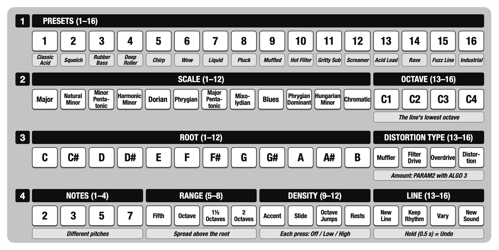

# 3 OH USER GUIDE

**3 OH** is an acid bass line voice for the Pērkons, on any of its four voices: one oscillator
through a model of the classic bass line synth's diode ladder filter, with its accents and
slides, four distortions to push it, and a **line generator** that writes acid lines straight
into the Pērkons sequencer.

* **The 303's knobs on the panel**: TUNE is the cutoff, PARAM1 the resonance, DECAY the decay,
  and PARAM2 the envelope amount, accent or distortion.
* **The real filter response.** The filter is the diode ladder's own response, with the bottom
  capacitor half the size of the others, and the resonance fed back through a high-pass so the
  bass stays when you turn it up. Cutoff, envelope and resonance work together the way the
  original's do.
* **Accent and slide**, the way the classic sequencer plays them: accented notes are louder and
  snappier and push the filter up, and accents close together climb higher and higher (the
  "wow"). Slid notes glide into each other without a new attack.
* **A line generator**: one press writes a whole acid line (notes, accents, slides, octave
  jumps) into the voice's track, in your key, or fills in the steps you've laid down yourself.
  It's an ordinary Pērkons pattern: you see it on the steps, LAST sets its length, and it's
  saved with the pattern.
* **Four distortions**, from a gentle buzz on the loud notes to a screaming filter overload.
* **16 presets** and **New sound**, saved with the kit.
* **Light on the processor**: about as much as a stock voice, a little more with distortion.

Based on official Pērkons firmware **1.3.0**. Unofficial; not affiliated with Erica Synths or
Roland.

## Getting it

The easiest way is the [Perkons Mod Matrix Desktop](https://github.com/remixed123/modmatrix-desktop#mod-matrix-desktop)
app for macOS and Windows: nothing else to install. Load your own official firmware 1.3.0,
tick **3 OH** and press **PATCH IT**. No firmware files are provided here. To remove it, flash the 
official firmware again.

voice-3-oh runs as a voice-map engine: in the Mod Matrix, on the **ENGINES** tab, tick
**ENABLE CUSTOM VOICE ENGINES**, then install 3 OH. It takes the slot you install it in.

## Putting it on a voice

On the voice-map engine page (hold KIT and press MOD), press 3 OH's column in the voice's row;
its next note plays 3 OH. **Hold that step for half a second** to open its
[configuration page](#the-configuration-page) for that voice. The voice's analog filter, DRIVE,
FX send and level stay with the voice; only the sound engine changes.

**Quick start:** open the configuration page, pick a scale and root, press **New line** (row 4,
step 13) and press PLAY. Turn TUNE, PARAM1 and DECAY while it plays.

## Controls

| control | what it does |
|---|---|
| **TUNE** | **Filter cutoff.** At 12 o'clock you hear the sound as saved; turn left to close the filter, right to open it. Lock it on steps for a filter sequence |
| **DECAY** | As on the original: how fast the **filter sweep** falls back after each note. Fully left it snaps shut within the note (a short, plucky blip); fully right it stays open and bright (about a second to fall back). Accented notes always get the fastest. It doesn't change how long the notes are: each plays for 58% of a sixteenth at the Pērkons's tempo, as the original sequencer gates it, unless it slides or ties into the next. Turn it up with some envelope amount for long, wailing sweeps. From about 95% up the note never releases: it **drones** |
| **PARAM1** | **Resonance**, around the sound's own at 12 o'clock |
| **PARAM2** | Its job depends on ALGO (below). At 12 o'clock you hear the sound as saved; turn either way from there |
| **ALGO** | Chooses PARAM2's job (positions top to bottom): 1: **envelope amount** (ENV MOD) 2: **accent**: how much an accented note stands out 3: **distortion amount** (fully left: clean) |
| **MODE** | The **waveform** (positions top to bottom): 1: **saw** 2: **square**, as the original's (a touch off 50%) 3: **narrow pulse**, thinner and nasal |
| CUTOFF, filter switch, DRIVE, FX SEND, LEVEL | The Pērkons's analog stages, as on every voice. 3 OH gets a little quieter as DRIVE goes up (+3 dB with no drive, -3 dB at full), so DRIVE changes the tone more than the volume |

* **PARAM2 keeps all three values.** When ALGO gives it another job, that value stays as it was
  until you move the knob; then the knob sets it.

## The configuration page

Each voice playing 3 OH has its own configuration page. To open it:

1. Hold **KIT** and press **MOD** (from any page) to open the voice-map engine page.
2. Find the voice's row and 3 OH's column (the slot you installed it in).
3. **Hold** that step for half a second. The configuration page for that voice opens. If
   the voice wasn't playing 3 OH yet, this also puts it on that voice.

The trigger keys still play the voices while the page is open, so you can hear every change.
Press **SHIFT**, **KIT** or **MOD** to go back to the engine page.

| row | steps 1-12 | steps 13-16 |
|---|---|---|
| 1 | [presets](#presets) 1-12 | presets 13-16 |
| 2 | **scale**: Major, Natural Minor, Minor Pentatonic, Harmonic Minor, Dorian, Phrygian, Major Pentatonic, Mixolydian, Blues, Phrygian Dominant, Hungarian Minor, Chromatic | **octave** of the line: C1, C2, C3, C4 |
| 3 | **root**: C to B | **[distortion type](#the-distortions)**: Muffler, Filter drive, Overdrive, Distortion |
| 4 | **[the line generator's settings](#the-line-generator)** | **New line**, **Keep rhythm**, **Vary**, **New sound** (hold: undo) |

Bright steps show what's chosen. The preset's step goes half bright once New sound has changed
it.

### The line generator

The generator writes into the **voice's own track** of the pattern playing: which steps play,
and each step's note and velocity. Everything else on the track stays: LAST and the other SHIFT
settings, parameter locks, ratchets, conditions. The line plays from the first step to LAST, so
**LAST sets its length**. It's saved when you save the pattern, like any edit.

Its settings (row 4, steps 1-12):

| steps | setting | options |
|---|---|---|
| 1-4 | **Notes**: how many different pitches | 2, 3, 5 or 7. Two or three is the sparse classic; seven is busy |
| 5-8 | **Range**: how far they spread above the root | a fifth, an octave, an octave and a half, two octaves |
| 9 | **Accent**: how many accents | each press: off, low, high (the step dim, medium, bright) |
| 10 | **Slide**: how many slides and ties | off, low, high |
| 11 | **Octave jumps**: notes an octave up (mostly) or down | off, low, high |
| 12 | **Rests**: how many steps New line leaves out | off (every step plays), low, high |

The notes come from the scale and root (row 2 and 3), starting at the octave you set; the root
comes up most often. Accents fall a little more often on the beat. Slides only go where the next
step that plays is close (at most two steps on), so a slide never holds a note through a long
gap.

The actions (row 4, steps 13-16), on release:

| step | action | what it does |
|---|---|---|
| 13 | **New line** | a whole new line: which steps play (by Rests), and every step's note, accent and slide |
| 14 | **Keep rhythm** | keeps the steps you've turned on and gives each one a new note, accent and slide: lay down your own groove, let it write the acid. On an empty track it works as New line |
| 15 | **Vary** | redraws three of the steps that play, keeping the rest of the line |
| 16 | **New sound** | a new sound from the preset: close to it, further, or a fresh acid recipe (a clean squelch, a deep roller, a screaming lead or a rave line). The line and its settings stay |

**Hold** any of the four for half a second to **undo** the last action, whichever it was.

### The distortions

Row 3, steps 13-16. PARAM2 on ALGO position 3 sets how much; fully left is clean.

| step | type | the sound |
|---|---|---|
| 13 | **Muffler** | Soft clipping after the amp, with the bass kept clean: a buzz on the loud notes and the accents, the low end untouched. Inspired by the classic "Muffler" modification |
| 14 | **Filter drive** | The oscillator pushed hard into the filter, up to 30 dB: thick and growling, and the harder you push the less it resonates, like an overloaded filter |
| 15 | **Overdrive** | A pedal-style overdrive with a mid-range push, over the clean sound: the classic acid-through-a-green-pedal snarl |
| 16 | **Distortion** | High gain and hard clipping: raw, fizzy and loud, for rave and industrial lines |

The level stays about the same as you turn the distortion up, so it changes the tone, not the
volume. Each preset has its own distortion tone, from dark to bright; New sound can change it.

### Presets

**Press** a preset step to load that preset's sound. Even on the preset already chosen, a press
loads its whole sound again and sets TUNE (cutoff) and PARAM1 (resonance) to 12 o'clock. The
line and the generator's settings stay.

| step | preset | the sound |
|---|---|---|
| 1 | **Classic Acid** | The textbook line: half-closed, resonant, a strong envelope |
| 2 | **Squelch** | Darker cutoff, high resonance and a big envelope: every note squelches |
| 3 | **Rubber Bass** | Low resonance and a gentle envelope: round and bouncy |
| 4 | **Deep Roller** | Low cutoff, a little Muffler buzz: a rolling sub line |
| 5 | **Chirp** | Full envelope with a short slide: chirpy, talking notes |
| 6 | **Wow** | Nearly full resonance and full accent: accents that climb and squeal |
| 7 | **Liquid** | Open and smooth, with long slides |
| 8 | **Pluck** | Bright and short, with a big envelope |
| 9 | **Muffled** | Muffler on: the loud notes buzz, the bass stays fat |
| 10 | **Hot Filter** | Filter drive: thick, saturated and growling |
| 11 | **Gritty Sub** | A low, heavily driven filter: dirty sub bass |
| 12 | **Screamer** | Overdrive with high resonance: the snarling acid lead |
| 13 | **Acid Lead** | Open cutoff, overdrive and longer slides: a lead line |
| 14 | **Rave** | Distortion with everything up: the hard rave line |
| 15 | **Fuzz Line** | Full distortion on a darker filter: a fuzz bass |
| 16 | **Industrial** | Full distortion, near-full resonance and a bright tone: harsh and loud |

Try each with MODE on square too.

## Saving

* **The sound** is saved with the **kit**: the preset and any New sound result, the distortion
  type, PARAM2's three values, and the generator's settings (scale, root, octave, notes, range,
  densities). A kit saved before 3 OH was on it plays the default presets: 1, 2, 10 and 14 on
  voices 1-4.
* **The line** is the track's steps, so it's saved with the **pattern**.

## MIDI and the sequencer

* MIDI notes play their own pitch (note 36 is C2); their velocity works as a step's.
* Parameter locks on TUNE lock the cutoff; locks and MIDI CCs on PARAM2 change whatever ALGO
  gives it when they play.
* Sequenced DECAY values change the sweep and the note length per step.
* The note length follows the Pērkons's tempo.

## Processor use

3 OH is a light engine: about as much as a stock voice when clean, a little more with a
distortion. It's fine on any voice, next to heavier engines too. The line generator runs on the
other core, when you press it, and costs the voices nothing.

## Credits

The filter follows the published analysis of the original's diode ladder (Tim Stinchcombe), the
zero-delay ladder of Vadim Zavalishin's *The Art of VA Filter Design*, and Dominique Wurtz's
input saturator. The cutoff and envelope mapping and the envelope times follow Robin Schmidt's
Open303 (MIT licence), which measured them from the original. The accent sweep and the Muffler
follow Robin Whittle's Devil Fish documentation. The line generator's rhythm follows the
on-beat weighting of Vitling's Acid Banger.
