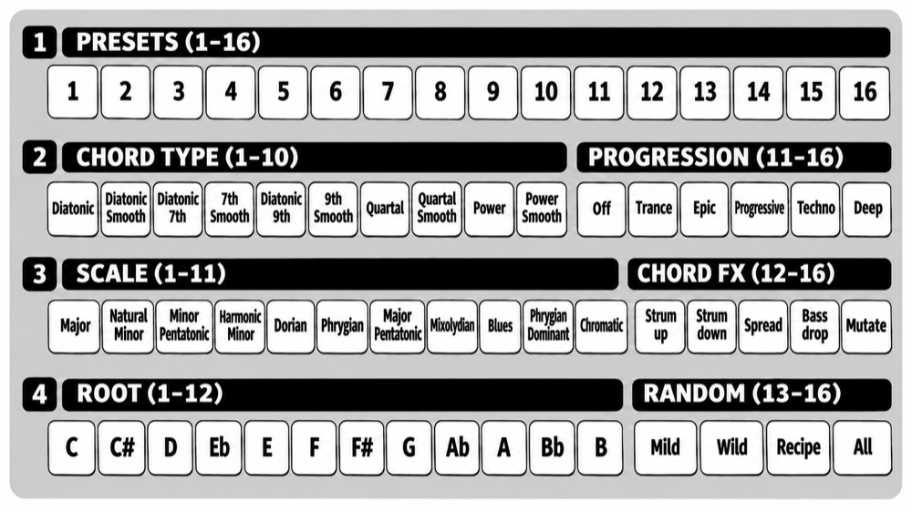

# AKORDS USER GUIDE

**AKORDS** is a chord synth voice for the Pērkons, on any of its four voices. Every note plays a
chord in your scale. The name is Latvian for "chord".

* **Chords from one note**: 3 to 5 notes in your scale, from triads to 7ths, 9ths, quartal and
  power chords.
* **Smooth chords** take the inversion nearest the chord before, so a sequence moves like a
  player's hands instead of jumping as a block.
* **Chord progressions** move the chord on once every cycle of the track: trance, epic,
  progressive, techno and deep house.
* **Scale and root**: TUNE plays only the chords of the key you set, in 11 scales and all 12
  roots.
* **16 presets**, from bass and pads to stabs, Reese and formant choirs, and **Random** to
  make new sounds of the same kind. Every sound is saved with the kit.
* **Strum, Spread and Bass drop** change how the chord is played: notes one after another,
  a wider voicing, a deeper bass note.

AKORDS takes its sound from a poly synth developed for iOS, reworked to get the most out of the
incredible-sounding Pērkons: two oscillators per chord note into a resonant filter with its own
envelope.

Based on official Pērkons firmware **1.3.0**. Unofficial; not affiliated with Erica Synths.

## Getting it

The easiest way is the [Perkons Mod Matrix Desktop](https://github.com/remixed123/modmatrix-desktop#mod-matrix-desktop)
app for macOS and Windows: nothing else to install. Load your own official firmware 1.3.0,
tick **AKORDS** and press **PATCH IT**. You can also run the Mod Matrix from perkons-re: follow
[Get modded firmware](https://github.com/kiteless/perkons-re#get-modded-firmware). No
firmware files are provided here. To remove it, flash the official
firmware again.

AKORDS runs as a voice-map engine: in the Mod Matrix, on the **ENGINES** tab, tick
**ENABLE CUSTOM VOICE ENGINES**, then install AKORDS. It takes the slot you install it in.

## Putting it on a voice

On the voice-map engine page (hold KIT and press MOD), press AKORDS' column in the voice's row; its next
note plays AKORDS. **Hold that step for half a second** to open its
[configuration page](#the-configuration-page) for that voice. The voice's analog filter, DRIVE, FX send
and level stay with the voice; only the sound engine changes.

## Controls

| control | what it does |
|---|---|
| **TUNE** | Picks the chord's root. It steps through the notes of the scale and root set on the configuration page, over four octaves (C2 to C6 with root C) |
| **DECAY** | Works as **GATE**: how long the chord holds before it releases, from 0.05 s to 2 s. From about 95% up, the chord never releases: it **drones** |
| **PARAM1** | **Filter cutoff** (with the formant filter: the vowel). At 12 o'clock you hear the preset's own; turn left to close the filter, right to open it |
| **PARAM2** | Its job depends on ALGO (below). At 12 o'clock you hear the preset's own; turn either way from there |
| **ALGO** | Chooses PARAM2's job (positions top to bottom): 1: **resonance** (with the formant filter: the **formant shift**, from an octave lower, a bigger, deeper voice, to an octave higher, a smaller, brighter one) 2: **filter envelope amount** 3: **amp attack** |
| **MODE** | Chooses the filter (positions top to bottom): 1: **24 dB low-pass** 2: **12 dB high-pass** 3: **formant**: shapes the chord into a vowel. PARAM1 sweeps it from dark to bright, **U O A E I**, and the filter envelope moves it on each chord |
| CUTOFF, filter switch, DRIVE, FX SEND, LEVEL | The Pērkons's analog stages, as on every voice. AKORDS gets a little quieter as DRIVE goes up (+3 dB with no drive, -3 dB at full), so DRIVE changes the tone more than the volume |

* **One chord sounds at a time**: a new note replaces the one before.
* **Each preset has its own filter** until you move MODE; then the filter follows the switch.
* **PARAM2 keeps all three values.** When ALGO gives it another job, that value stays as it was
  until you move the knob; then the knob sets it.
* **Turning DECAY down from drone** releases the chord playing.

## The configuration page

Each voice playing AKORDS has its own configuration page. To open it:

1. Hold **KIT** and press **MOD** (from any page) to open the voice-map engine page.
2. Find the voice's row and AKORDS' column (the slot you installed it in).
3. **Hold** that step for half a second. The configuration page for that voice opens. If
   the voice wasn't playing AKORDS yet, this also puts it on that voice.

The trigger keys still play the voices while the page is open, so you can hear every change.
Press **SHIFT**, **KIT** or **MOD** to go back to the engine page. On each row, the bright
step is the one chosen.

### Presets (row 1)

**Press** a preset step to load that preset. Even on the preset already chosen, a press gives
you its own sound again: cutoff, resonance, filter envelope amount, attack and filter all go
back to the preset's, whatever the knobs and MODE say. Each control takes over again when you
move it.

| step | preset | | step | preset |
|---|---|---|---|---|
| 1 | **Bass**: firm, round low chords with a punchy attack | | 9 | **Organ**: clean organ chords that hold |
| 2 | **Pad**: slow attack and long release, a wash | | 10 | **Bell**: glassy bells with a long decay |
| 3 | **Lead**: bright and forward, with glide between chords | | 11 | **Air**: thin, bright and airy, through the high-pass filter |
| 4 | **Keys**: plucky, electric-piano-like chords | | 12 | **Choir**: a slow, sung choir on "ah" (formant) |
| 5 | **Pluck**: short, no sustain | | 13 | **Vox**: a vocal "wow" on every chord (formant) |
| 6 | **Stab**: short, resonant house and techno stabs | | 14 | **Talk**: talking, wah-like chords (formant) |
| 7 | **Hollow**: reedy and hollow, sustained | | 15 | **Chant**: a deep monk choir on "oh", slowly opening towards "ah" (formant) |
| 8 | **Reese**: two saws detuned hard, thick and beating, with glide | | 16 | **Wah**: every chord says "wah", the vowel jumping open and falling back (formant) |

Glide slides each note of a new chord from the matching note of the chord before.

### Chord types (row 2, steps 1-10)

Each type comes plain and **smooth**.

| step | chord | notes |
|---|---|---|
| 1 | **Diatonic** | the triad the scale gives on that note: in C major, C, Dm, Em, F, G, Am, B° |
| 2 | Diatonic, smooth | |
| 3 | **Diatonic 7th** | the same with its 7th (4 notes): Cmaj7, Dm7, Em7, Fmaj7, G7, Am7, Bm7♭5 |
| 4 | Diatonic 7th, smooth | |
| 5 | **Diatonic 9th** | the 7th chord with its 9th (5 notes): Cmaj9, Dm9, G9 ... |
| 6 | Diatonic 9th, smooth | |
| 7 | **Quartal** | four notes in fourths (root, 4, ♭7, ♭10): the dub techno stab |
| 8 | Quartal, smooth | |
| 9 | **Power** | root, 5, octave: for bass and Reese |
| 10 | Power, smooth | |

* **Plain types play in root position**: the chord moves up and down as a block.
* **Smooth types** take the inversion nearest the chord before (C to F plays C F A, not
  F A C), staying within about an octave of TUNE. After a silence they start again in root
  position.
* On pentatonic and blues scales, the diatonic types take the nearest notes the scale has, and
  a sus chord where it has no third. On Chromatic, Diatonic plays major chords, Diatonic 7th
  minor 7ths and Diatonic 9th minor 9ths.

### Progressions (row 2, steps 11-16)

The chord moves on **once every cycle of the voice's track**: every 16 steps on a 16-step
track, every 9 on a 9-step one.

| step | progression | chords | style |
|---|---|---|---|
| 11 | **Off** | TUNE alone | |
| 12 | **Trance** | i – VI – III – VII | trance and uplifting: Cm, A♭, E♭, B♭ in C minor |
| 13 | **Epic** | i – VI – VII – v | epic and cinematic builds: Cm, A♭, B♭, Gm |
| 14 | **Progressive** | i – v – VI – iv | progressive house, melodic techno: Cm, Gm, A♭, Fm |
| 15 | **Techno** | i – VI | a dark, hypnotic two-chord vamp: Cm, A♭ (two notes stay, one moves) |
| 16 | **Deep** | i – iv | a two-chord deep house vamp: Cm, Fm |

* **TUNE sets the first chord**, and the progression moves from it through the scale.
* They're written for the **minor scales**. In other scales they take the same scale steps, so
  they give different chords.
* The progression restarts when the sequencer starts or stops, and when the pattern changes.
* In other play modes, the chord moves on each time the track returns to its first step; on a
  one-step track it never moves on.

### Scales (row 3)

| step | scale | notes from C | character, and where you hear it |
|---|---|---|---|
| 1 | **Major** | C D E F G A B | bright and resolved: pop, house, uplifting trance |
| 2 | **Natural Minor** | C D E♭ F G A♭ B♭ | dark and moody: the everyday minor of techno, trance, drum & bass and most dark electronic music |
| 3 | **Minor Pentatonic** | C E♭ F G B♭ | five notes with no semitones: rock, blues, funk, hip-hop |
| 4 | **Harmonic Minor** | C D E♭ F G A♭ B | minor with a raised 7th that pulls hard back to the root: classical, metal, epic trance, film music |
| 5 | **Dorian** | C D E♭ F G A B♭ | minor but warmer, with a bright 6th: deep house, dub techno, funk, soul, jazz |
| 6 | **Phrygian** | C D♭ E♭ F G A♭ B♭ | minor with a tense ♭2 a semitone above the root: dark techno, metal, flamenco |
| 7 | **Major Pentatonic** | C D E G A | open and sunny, five notes: folk, country, pop, chillout |
| 8 | **Mixolydian** | C D E F G A B♭ | major with a bluesy ♭7: rock, funk, disco, Afro house |
| 9 | **Blues** | C E♭ F F♯ G B♭ | the minor pentatonic plus the "blue" ♭5: blues, jazz, rock, hip-hop |
| 10 | **Phrygian Dominant** | C D♭ E F G A♭ B♭ | the Spanish / Middle-Eastern scale of flamenco, psytrance and dark techno. Its chords: C, D♭, E°, Fm, G°, A♭+, B♭m |
| 11 | **Chromatic** | all 12 notes | no key: TUNE steps by semitones, for experimental and atonal parts |

### Chord FX (row 3, steps 12-16)

Each step turns its effect on or off for the voice, on its own: press again to turn it off;
bright is on. Only one strum is on at a time.

| step | effect | what it does |
|---|---|---|
| 12 | **Strum up** | the notes start one after another, low to high, 45 ms apart, like a strummed guitar. The chord holds at full level until its last note is in |
| 13 | **Strum down** | the same, high to low |
| 14 | **Spread** | opens the chord: the second-highest note plays an octave lower, so the chord spans wider |
| 15 | **Bass drop** | the chord's lowest note plays an octave lower |
| 16 | **Mutate** | every chord plays a variation of the sound: cutoff (up to most of an octave either way), resonance, envelopes, detune, level. Each variation starts from the saved sound, so a pattern keeps moving without drifting away |

* **Strum** suits keys, plucks and stabs. With Strum up on one voice and Strum down on
  another, playing the same chords, the two answer each other.
* **Spread and Bass drop** work with every chord type, together or alone, and with the smooth
  types: the smooth voicing is worked out first, then the notes move.

### Root (row 4, steps 1-12)

| step | 1 | 2 | 3 | 4 | 5 | 6 | 7 | 8 | 9 | 10 | 11 | 12 |
|---|---|---|---|---|---|---|---|---|---|---|---|---|
| root | C | C♯ | D | E♭ | E | F | F♯ | G | A♭ | A | B♭ | B |

### Random (row 4, steps 13-16)

Random makes a new sound of the current preset's kind (bass, pad, lead, keys, pluck, or
air and vocal). It changes only the sound: the chord type, progression, scale, root and the
Chord FX stay as you set them.

| step | Random | what you get |
|---|---|---|
| 13 | **Mild** | the preset with every value moved a little |
| 14 | **Wild** | the preset taken further: waveforms, octaves, detune, filter type, cutoff and envelopes can all change |
| 15 | **Recipe** | a fresh sound built from a recipe of the preset's kind, such as a Reese, an acid bass, a choir or an organ |
| 16 | **All** | one of the three, picked at random |

* **Each press is a new sound.** The preset step glows medium while the sound is a Random one.
* **Hold** a Random step for half a second to undo the last Random.
* **Press the preset** to go back to its own sound.
* As with a preset press, the PARAM knobs start again from the new sound's own values: at 12
  o'clock you hear the sound as Random made it.

## Saving

Each voice's configuration page settings are saved with the kit, including its Chord FX and
its Random sound, and leaving the page after a change saves them to the card straight away.
Saving the kit also keeps the sound you made: PARAM2's three values, the filter (the preset's
own or the one chosen with MODE), and the preset's values after a preset press, for any knob
you haven't moved since.

A kit saved with an earlier version of AKORDS plays from its knob positions, as it did before,
until you save it again.

## MIDI and the sequencer

* Notes transpose the chord: note 36 means no change, and each note above or below moves the
  whole chord, scale included, by a semitone.
* Sequenced DECAY values give per-step gate lengths.
* Parameter locks and MIDI CCs on PARAM2 change whatever ALGO gives it when they play.
