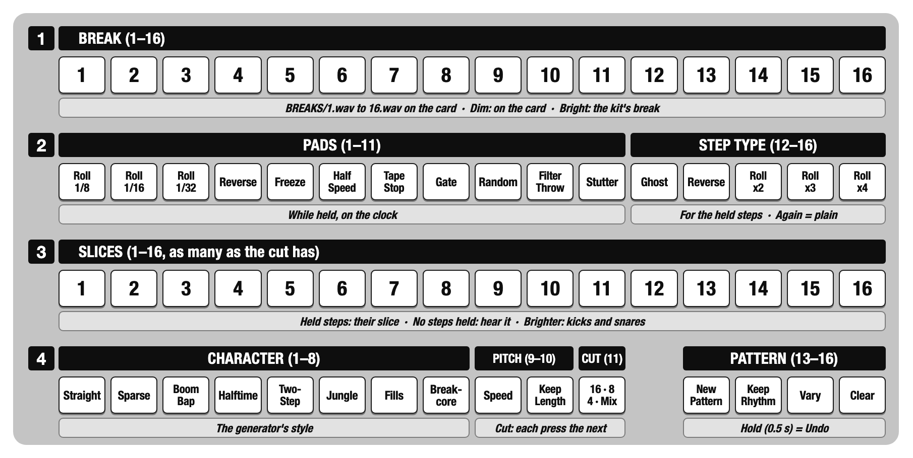

# BREAK MAKER USER GUIDE

**BREAK MAKER** turns any of the Pērkons's four voices into a **drum break player**: a one-bar
break from the SD card, cut into slices on the drum hits (16, 8 or 4 of them, or one per hit),
playing as a running loop locked to the sequencer. You chop it by programming the steps where it should jump, mangle it live with
**pads**, and let a **generator** write new patterns from it.

* **A running loop, not a sampler.** Press PLAY and the break plays across the 16 steps at
  whatever tempo: it always fits the bar. Steps without a trigger keep it
  running.
* **A trigger is a jump.** A step with a trigger plays the slice you lock on it (PARAM2) and the
  break carries on from there, the classic jungle chop. The loop's first step puts it back in
  place.
* **How each step plays**, set on the page or by the generator: ghost (quiet), reverse, rolls
  of 2, 3 or 4 inside the step, or reverse and roll together.
* **11 pads**, while held, on the clock: rolls, reverse, freeze, half speed, tape stop, gate,
  random, filter throw, stutter.
* **A generator** that knows the break's kicks, snares and hats: eight characters from Straight
  to Breakcore rearrange pieces of the bar (a step, two steps, a beat, or mixed) and write a new pattern into the voice's track, as
  ordinary steps you can edit.
* **Chop mode** for building new beats from the break's hits.
* **Very light on the processor**: about as much as a stock voice.

Based on official Pērkons firmware **1.3.0**. Unofficial; not affiliated with Erica Synths.

## Getting it

The easiest way is the [Perkons Mod Matrix Desktop](https://github.com/remixed123/modmatrix-desktop#mod-matrix-desktop)
app for macOS and Windows: nothing else to install. Load your own official firmware 1.3.0,
tick **BREAK MAKER** and press **PATCH IT**. No firmware files are provided here. To remove it,
flash the official firmware again.

voice-break-maker runs as a voice-map engine: in the Mod Matrix, on the **ENGINES** tab, tick
**ENABLE CUSTOM VOICE ENGINES**, then install BREAK MAKER. It takes the slot you install it in.

**BREAK MAKER and STEP SAMPLER can't be installed together**: the break lives in the memory the
Pērkons keeps for custom samples, which STEP SAMPLER uses too. While BREAK MAKER is installed,
the stock sampler (voice 4, ALGO 3) plays its factory closed hat, open hat and ride.

## Breaks on the card

Put up to 16 breaks on the card as `BREAKS/1.wav` to `BREAKS/16.wav`. A bank can have its own:
`BANKS/NN/BREAKS/n.wav` is used before `BREAKS/n.wav` (bank 1 is `BANKS/00`).

* **Loops of 1, 2 or 4 bars**, cut exactly at the start and end. BREAK MAKER plays the **first
  bar**, as 16 steps, at the Pērkons's tempo (its own tempo doesn't matter).
* **How many bars** it works out when the break loads: whichever makes the loop's own tempo
  closest to the Pērkons's tempo then. A 4-second loop at 120 BPM is 2 bars, not 1 bar at 60.
  A loop that could be either (2 bars at 175 BPM is also 1 bar at 87.5) goes by the tempo set:
  set the Pērkons near the loop's tempo before choosing it.
* **WAV, mono, 16-bit**, 44.1 kHz (other rates play too). Stereo, 24-bit or other files are
  ignored.
* **The bar played can be up to about 4.4 seconds** at 44.1 kHz (down to about 54 BPM). Anything
  longer is cut.
* **Slices:** see [the cut](#the-cut). If the WAV has exactly 16 cue points (most audio editors
  can add markers that save as cue points), those are used for 16, 8 and 4 slices.
* **The break loads when a voice plays BREAK MAKER** (not when the Pērkons starts, so start-up
  stays quick), and again when you choose another one. Loading takes a moment, during which the
  voice is silent.

One break is in memory at a time: every voice running BREAK MAKER plays the kit's break.

No breaks come with BREAK MAKER. Royalty-free Amen loops, such as Cyberworm's collections, are a
good place to start.

## Putting it on a voice

On the voice-map engine page (hold KIT and press MOD), press BREAK MAKER's column in the voice's
row. **Hold that step for half a second** to open its [configuration page](#the-configuration-page)
for that voice. The voice's analog filter, DRIVE, FX send and level stay with the voice; only
the sound engine changes.

**Quick start:** put a break on the card as `BREAKS/1.wav`, put BREAK MAKER on a voice and press
PLAY: the break plays. Open the configuration page, press **Jungle** (row 4, step 6) and then
**New pattern** (row 4, step 13).

## Controls

| control | what it does |
|---|---|
| **TUNE** | **Pitch** in semitones, up to an octave either way. At 12 o'clock the break plays as recorded (at the Pērkons's tempo). How pitch works (speed or keep length) is set on the page. A step's note transposes it too (MIDI note 36: no change) |
| **DECAY** | **Gate**: how much of each slice sounds, from a tight chop to all of it. At the top (from about 95%) there's no gate: the break runs on. **Start fully right**, and turn it down for a chopped sound: with the cut at 16 a slice is only a step long, so the gate shortens every hit. In CHOP mode: how long each hit lasts, up to four steps, or until the next one at the top |
| **PARAM1** | Its job depends on MODE (below). Lock it on steps to use it on just those steps |
| **PARAM2** | **The slice a trigger plays.** Fully left: the slice where the step is, from that step (the break in place); then a zone for each slice. Lock it on a step (hold the step and turn it) to make that step jump |
| **ALGO** | How the break plays (positions top to bottom): 1: **RUN**: the break loops; a trigger jumps and the break carries on from there 2: **GENERATE**: RUN, and the steps without a trigger may play other slices, a little different each bar, busier every fourth bar 3: **CHOP**: only triggers play, each its slice, silent after the gate |
| **MODE** | PARAM1's job (positions top to bottom): 1: **ROLL**: off, then 2, 3, 4, 6 or 8 hits inside the step 2: **MANGLE**: how often a step plays a different slice (in GENERATE: how much it changes) 3: **STUTTER**: a short piece of the slice looped for the step, from half a step down to 1/32 |
| velocity | **How the step plays** (see [step types](#step-types)); it doesn't set the level |
| CUTOFF, filter switch, DRIVE, FX SEND, LEVEL | The Pērkons's analog stages, as on every voice |

### The cut

How many slices the bar is cut in, chosen on the page (row 4, step 11: each press the next) and
saved with the kit. You can change it while the break plays: it's cut again at once.

| cut | the slices | LED |
|---|---|---|
| **16** | a sixteenth each, one a step | bright |
| **8** | an eighth each (2 steps): the classic Amen chop | medium |
| **4** | a beat each (4 steps) | dim |
| **Mix** | 16 slices, but the generator plays them in **pieces of 1, 2 or 4 steps, mixed in the same bar** | blinking |

Each cut is moved onto the drum hit nearest it, so each slice starts on its hit
even if the drummer was a little early or late. A slice starts on its own step and plays on
through the steps it covers; a trigger inside a slice jumps from there. PARAM2's zones follow the
cut (fewer slices, wider zones), so a locked step keeps about its place in the bar when you
change it.

### Step types

A step's velocity says how it plays. A step you turn on by hand plays plain; the page and the
generator set the others. With MIDI velocity on, notes recorded or played from an external
sequencer choose them too, so a sequencer's velocity lane can play rolls and reverses.

| velocity | the step plays |
|---|---|
| 112-127 | plain |
| 96-111 | ghost: 12 dB quieter |
| 80-95 | reversed |
| 64-79 | a roll of 2 inside the step |
| 48-63 | a roll of 3 |
| 32-47 | a roll of 4 |
| 1-31 | reversed, and a roll of 2 |

## The configuration page

Each voice playing BREAK MAKER has its own configuration page. To open it, either:

* **Hold** the voice's BREAK MAKER step on the engine page for half a second, or
* on the main page, **hold one or more steps** of a BREAK MAKER track and press **SHUFFLE**: the
  page then works on those steps (their slice and step type).

The trigger keys still play the voices while the page is open. **SHUFFLE** goes back to the main
page; **SHIFT**, **KIT** or **MOD** to the engine page.

| row | steps | what they do |
|---|---|---|
| 1 | 1-16 | **The break**: `BREAKS/1.wav` to `16.wav`. Dim: on the card; bright: the kit's |
| 2 | 1-11 | **Pads**, while held: roll 1/8, roll 1/16, roll 1/32, reverse, freeze, half speed, tape stop, gate, random, filter throw, stutter |
| 2 | 12-16 | **Step types** for the held steps: ghost, reverse, roll x2, roll x3, roll x4. The held steps' type is lit; press it again for plain. Reverse and roll x2 together: both |
| 3 | 1-16 | **Slices** (as many as the cut has): with held steps, their slice (a lock on PARAM2); without, hear it. Brighter: the kicks and snares |
| 4 | 1-8 | **The generator's character**: Straight, Sparse, Boom bap, Halftime, Two-step, Jungle, Fills, Breakcore |
| 4 | 9-10 | **Pitch**: speed (pitch and speed together, as a sampler) or keep length (pitch without changing the slices' length) |
| 4 | 11 | **The cut**: each press the next, 16, 8, 4, Mix ([the cut](#the-cut)) |
| 4 | 13-16 | **New pattern**, **Keep rhythm**, **Vary**, **Clear** (on release). **Hold** any of them for half a second to undo the last |

### The pads

| pad | while held |
|---|---|
| roll 1/8, 1/16, 1/32 | The slice playing when you press it, again and again at that rate |
| reverse | Everything plays backwards |
| freeze | A quarter-step piece of where it is, looped |
| half speed | An octave down, half as fast |
| tape stop | Slows to a halt over a beat; let go and it's back in place |
| gate | Chops it in 1/32 notes |
| random | Each step plays a random slice |
| filter throw | A low-pass filter falls over a beat; let go and it opens |
| stutter | A 1/32-step piece of where it is, looped: a buzzing stutter |

### The generator

BREAK MAKER sorts the break's slices into **kicks, snares, hats and ghost notes** when it loads,
so the generator can put them where they belong. A press on **New pattern** writes a whole bar
into the voice's track, in the character chosen.

It chops the way breaks are chopped: the bar is rearranged in **pieces of the bar**. The cut sets
how long a piece is:

* **16**: a step (a single hit).
* **8**: two steps (a kick and its hat, a snare and its ghost).
* **4**: a beat.
* **Mix**: 1, 2 or 4 steps, mixed in the same bar.

A piece always comes from a place of its own length in the bar (a 2-step piece from an even step,
a beat from a beat) and plays as it is in the break. The character says which pieces go where,
and in Mix, how the lengths mix:

| character | | Mix |
|---|---|---|
| **Straight** | the break, with one to three pieces swapped for others of their kind | mostly beats |
| **Sparse** | kick and snare pieces on the beats, room between (in CHOP): leaves space for the other voices | beats and pairs |
| **Boom bap** | kicks on 1 and 3, snares on 2 and 4, a doubled kick before 3 or 4 (slower breaks) | beats and pairs |
| **Halftime** | the snare on 3 only | mostly beats |
| **Two-step** | drum & bass: kick on 1 and the "and" of 3, snares on 2 and 4 | pairs and beats |
| **Jungle** | snares on 2 and 4, everything else shuffled, ghost notes, the last piece rolled | pairs and single steps |
| **Fills** | the break, then a busy last quarter, rolled and reversed | beats, then single steps |
| **Breakcore** | anything, rolls and reverses | mostly single steps |

When the break plays on from one slice into the next (a piece of 2 or 4 steps, or no jump at
all), it isn't restarted: with DECAY up, a piece sounds as one.

* **Keep rhythm** draws new slices for the steps that are on.
* **Vary** changes a few of them.
* **Clear** removes them: the break plays straight.
* In **RUN** and **GENERATE**, the generator only writes the steps where a piece jumps or a
  step plays differently, so the steps stay readable. In **CHOP** it writes every slice of each
  piece, and the characters' gaps are silent.

What it writes is an ordinary Pērkons pattern: you see it on the steps, LAST sets its length, and
it's saved with the pattern. If a break has no clear kick or snare, the generator places slices
by their position in the bar instead.

## Saving

**Saved with the kit:** the break and its cut, and for each voice the generator's character and the pitch
mode. **Saved with the pattern:** the steps, with their slices (PARAM2 locks) and step types
(velocities), as any Pērkons pattern.

## MIDI and the sequencer

* MIDI note 36 (what the trigger keys and pads send) plays the step's slice; other notes
  transpose it a semitone each.
* The trigger keys play while the sequencer runs (a jump) and while it's stopped (the slice on
  PARAM2, at the break's own speed).
* Track length (LAST), track rate and shuffle all apply: the break follows the sequencer's own
  steps.

## Processor use

BREAK MAKER uses about as much processor as a stock voice, a little more with keep length on.

## Credits

The ideas behind BREAK MAKER (the running break, the pads, the live generator's anchors, rolls and
fills) come from [CHOPPAH](https://github.com/profikid/fm1-break-choppah), the breakbeat chopper
for the M-VAVE FM-1 by Laurens Profittlich (MPL-2.0).
