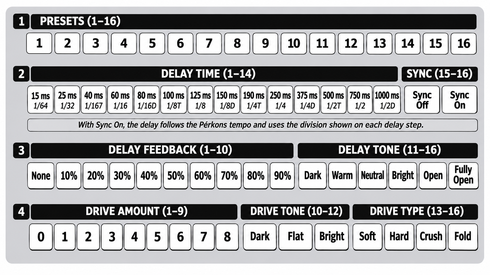

# KICK LAB USER GUIDE

**KICK LAB** is a kick drum voice for the Pērkons, on any of its four voices. It goes from a
solid, clean kick to dirty, distorted texture.

* **A swept kick** with a noise click, a resonant body and a low rumble, from a 30 ms click
  to a 4 s drone.
* **Drive** in four types: **soft**, **hard**, **crush** and **fold**. Crush and fold push the
  Pērkons into extreme territory.
* **A delay** that syncs to the tempo and turns single hits into rhythms.
* **Noise layers**: white or pink noise on top of the kick, fading with it.
* **16 presets**, from a plain sine kick to folded hammers and dub echoes, saved with the kit.

KICK LAB is a single engine port of Bruno Drum Synth, a drum synthesiser developed for iOS,
reworked to get the most out of the incredible-sounding Pērkons.

Based on official Pērkons firmware **1.3.0**. Unofficial; not affiliated with Erica Synths.

## Getting it

The easiest way is the [Perkons Mod Matrix Desktop](https://github.com/remixed123/modmatrix-desktop#mod-matrix-desktop)
app for macOS and Windows: nothing else to install. Load your own official firmware 1.3.0,
tick **KICK LAB** and press **PATCH IT**. You can also run the Mod Matrix from perkons-re: follow
[Get modded firmware](https://github.com/kiteless/perkons-re#get-modded-firmware). No
firmware files are provided here. To remove it, flash the official
firmware again.

KICK LAB runs as a voice-map engine: in the Mod Matrix, on the **ENGINES** tab, tick
**ENABLE CUSTOM VOICE ENGINES**, then install KICK LAB. It takes the slot you install it in.

## Putting it on a voice

On the voice-map engine page (hold KIT and press MOD), press KICK LAB's column in the voice's row; its next
note plays KICK LAB. **Hold that step for half a second** to open its
[configuration page](#the-configuration-page) for that voice. The voice's analog filter, DRIVE, FX send
and level stay with the voice; only the sound engine changes.

## Controls

| control | what it does |
|---|---|
| **TUNE** | The kick's pitch, from 20 to 200 Hz |
| **DECAY** | How long the kick rings, from a 30 ms click to 4 s. From about 95% up, the kick never fades: it **drones** until you turn DECAY down or play it again |
| **PARAM1** | **Sweep**: how far above the pitch each hit starts, up to 500 Hz. The pitch falls back in a few tens of milliseconds. Presets with saturation saturate harder as it rises |
| **PARAM2** | Its job depends on ALGO (below) |
| **ALGO** | Chooses PARAM2's job (positions top to bottom): 1: **attack**, from 1 to 100 ms: a soft start takes the click off 2: **delay mix**: up to halfway the echoes come up under the full kick; past halfway the kick fades, leaving only the echoes at full. 0 turns the delay off 3: **drive mix**: blends the drive with the clean kick; 0 turns the drive off |
| **MODE** | Adds a noise layer (positions top to bottom): 1: **clean**: no noise 2: **white noise**: bright hiss 3: **pink noise**: darker, rounder The noise fades with DECAY and holds in drone |
| CUTOFF, filter switch, DRIVE, FX SEND, LEVEL | The Pērkons's analog stages, as on every voice. They come after everything KICK LAB does, so the panel's DRIVE adds its own analog drive on top |

* **PARAM2 keeps all three values.** When ALGO gives it another job, that value stays as it was
  until you move the knob; then the knob sets it.
* The drive and the delay are heard only with their mix up: a preset without them has its mix
  at 0.

## The configuration page

Each voice playing KICK LAB has its own configuration page. To open it:

1. Hold **KIT** and press **MOD** (from any page) to open the voice-map engine page.
2. Find the voice's row and KICK LAB's column (the slot you installed it in).
3. **Hold** that step for half a second. The configuration page for that voice opens. If
   the voice wasn't playing KICK LAB yet, this also puts it on that voice.

The trigger keys still play the voices while the page is open, so you can hear every change.
Press **SHIFT**, **KIT** or **MOD** to go back to the engine page. On each row, the bright
step is the one chosen.

### Presets (row 1)

**Press** a preset step to load that preset. Even on the preset already chosen, a press loads
its whole sound again: rows 2-4, PARAM2's three values, and TUNE, DECAY and PARAM1. The knobs
pick those up as they do after a kit load: turn one and it takes over.

Each preset also sets the parts of the sound that have no control of their own: the click,
the waveform, the saturation, how the pitch falls, the resonant body and the rumble.

| step | preset | | step | preset |
|---|---|---|---|---|
| 1 | **Basic**: a plain sine kick | | 9 | **Drop**: a long slide down in pitch |
| 2 | **Tight Techno**: short, soft drive | | 10 | **8x Melodic Sub**: a long, tuneful sub |
| 3 | **9x Punch**: a hard click | | 11 | **8x Sub Boom**: a long boom with a resonant body |
| 4 | **8x Punch**: a tick, a body and a little rumble | | 12 | **Sustained**: a long kick with a rumble tail |
| 5 | **Warm House**: rounded, a little drive | | 13 | **Hammer**: low and long, folded, with a rumble |
| 6 | **Boom Bap**: saturated, a dusty body | | 14 | **Lo-Fi Crush**: crushed, with a short echo |
| 7 | **Acoustic**: a natural body, no drive | | 15 | **Dub Echo**: synced dotted eighths, long feedback |
| 8 | **Hardstyle Rave**: hard drive, saturated | | 16 | **Spring Thud**: a thud and a dark echo |

### The delay (rows 2 and 3)

| step | 1 | 2 | 3 | 4 | 5 | 6 | 7 | 8 | 9 | 10 | 11 | 12 | 13 | 14 |
|---|---|---|---|---|---|---|---|---|---|---|---|---|---|---|
| time (ms) | 15 | 25 | 40 | 60 | 80 | 100 | 125 | 150 | 190 | 250 | 375 | 500 | 750 | 1000 |
| division | 1/64 | 1/32 | 1/16T | 1/16 | 1/16D | 1/8T | 1/8 | 1/8D | 1/4T | 1/4 | 1/4D | 1/2T | 1/2 | 1/2D |

* **Sync on** (step 16): the delay follows the Pērkons's tempo. Below 60 BPM, the longest
  divisions play at half their time, still on the beat.
* **The echoes ring on** after the kick ends. A new time, or a big jump in tempo, crossfades to
  the new echo instead of sliding into it.
* **The longer the time, the darker the echoes**: short times keep the click, and 1/2D at
  60 BPM (three seconds) is a low thud.
* **The tone** (row 3, steps 11-16) darkens the echoes further, each repeat more than the one
  before.
* **High feedback stays at about the kick's own level**: as the feedback goes up, the echoes
  start a little quieter, so the repeats piling up between hits don't make the kick louder
  and louder. The repeats, their spacing and how long they ring on are the same.

### The drive (row 4)

The drive comes before the delay, so the echoes repeat the driven sound. It's
level-compensated: more amount changes the character more than the loudness.

Each type shapes the kick in its own way. The amount (steps 1-9) sets how hard the kick is
pushed into it, and the drive mix (PARAM2 on ALGO 3) blends the result with the clean kick, so
even the harshest type can sit under a clean kick as texture.

* **Soft** (step 13): smooth saturation that rounds the peaks off. Low amounts add warmth and
  weight; high amounts squash the kick into a thick, compressed, sustaining thump. The most
  forgiving type: the kick keeps its shape. Used by Tight Techno, Warm House and Dub Echo.
* **Hard** (step 14): the peaks are cut off flat. It's brighter and buzzier than soft, and at
  full amount the body turns towards a square wave: a loud, aggressive, hardstyle kick. Used
  by Hardstyle Rave.
* **Crush** (step 15): a bit crusher. Each step of the amount takes bits away, from a faint
  grain at step 1 down to just a few levels at step 9, where the decay breaks into steps and
  the tail turns to grit. Some presets also lower the sample rate, which adds the aliased,
  metallic crunch of old samplers. Used by Lo-Fi Crush.
* **Fold** (step 16): instead of being cut off, the wave folds back on itself each time it
  passes the top, then folds again as the amount rises. This adds bright, shifting harmonics
  that move as the pitch sweeps and the kick decays, so every hit changes over its length.
  Low kicks turn metallic and clangy; with the sweep up, the attack sounds almost like a
  zap. The most extreme type. Used by Hammer.

Soft, hard and fold run at twice the sample rate inside, so even at full amount they stay
clean of the harsh aliasing a plain digital drive would add. Crush is the exception: its
aliasing is the point.

Some presets push the drive off-centre, so it treats the top and bottom of the wave
differently. That adds a hollow, tube-like edge to soft and hard, and a lopsided fold.

The drive tone tilts the drive's output dark or bright around 1 kHz.

## Level

Velocity sets the level. A limiter at the end holds the peaks near those of the stock kick, so
the drive, a long feedback or a noise layer can't push it into clipping.

## Saving

Each voice's preset, rows 2-4 and PARAM2's three values are saved with the kit, and the sound
comes back when the kit loads, whether the sequencer is playing or not. A kit saved before
KICK LAB was on it plays Basic.

## MIDI and the sequencer

* Notes transpose: note 36 means no change, and each note above or below moves the pitch by a
  semitone.
* Sequenced TUNE values give per-step pitches; sequenced DECAY values give per-step lengths.
* Parameter locks and MIDI CCs on PARAM2 change whatever ALGO gives it when they play.
* The synced delay follows the Pērkons's tempo.

## Tips

* **Rhythm from one hit**: Dub Echo, a kick on beat one only, feedback up. Change the division
  on the page while it plays.
* **Industrial**: Hammer, drive amount up, ALGO on 3 and PARAM2 up, and the panel's DRIVE up
  too.
* **Broken machine**: Lo-Fi Crush, a short DECAY, the delay at 15 or 25 ms with high feedback.
* **Noise burst**: any preset, MODE on white noise, a short DECAY and a short delay.
* **Shifting texture**: drive type fold with the drive mix up (ALGO on 3, PARAM2), then
  parameter-lock MODE to clean, white or pink noise on different steps, and TUNE and DECAY on
  each step: every hit folds differently.
