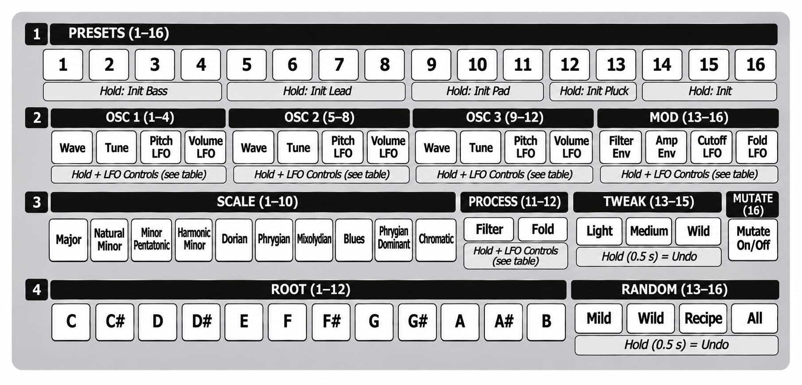

# SYNTH LAB USER GUIDE

**SYNTH LAB** is a monophonic synth voice for the Pērkons, on any of its four voices.

* **Three oscillators**, each with its own waveform, tuning and LFOs.
* **16 presets** to start from, and every part of the sound is yours to shape: build your own
  sounds exactly the way you want them, and save them with the kit.
* **Random** makes new sounds from the preset's character, and **Tweak** nudges the sound
  that's playing, a little or a lot.
* **Scale and root**: TUNE plays only the notes of the key you set.
* **Hard sync with filter sweeps**: the classic sync scream, swept on every note.

SYNTH LAB is a port of Marco Synth, a synthesiser developed for iOS, reworked to get the most
out of the incredible-sounding Pērkons.

Based on official Pērkons firmware **1.3.0**. Unofficial; not affiliated with Erica Synths.

## Getting it

The easiest way is the [Perkons Mod Matrix Desktop](https://github.com/remixed123/modmatrix-desktop#mod-matrix-desktop)
app for macOS and Windows: nothing else to install. Load your own official firmware 1.3.0,
tick **voice-synth-lab** and press **PATCH IT**. You can also run the Mod Matrix from perkons-re: follow
[Get modded firmware](https://github.com/kiteless/perkons-re#get-modded-firmware). No
firmware files are provided here. To remove it, flash the official
firmware again.

voice-synth-lab runs as a voice-map engine: in the Mod Matrix, on the **ENGINES** tab, tick
**ENABLE CUSTOM VOICE ENGINES**, then install SYNTH LAB. It takes the slot you install it in.

## Putting it on a voice

On the voice-map engine page (hold KIT and press MOD), press SYNTH LAB's column in the voice's row; its next
note plays SYNTH LAB. **Hold that step for half a second** to open its
[configuration page](#the-configuration-page) for that voice. The voice's analog filter, DRIVE, FX send
and level stay with the voice; only the sound engine changes.

## Controls

| control | what it does |
|---|---|
| **TUNE** | Picks the note. It steps through the notes of the scale and root set on the configuration page, from C2 to C6. The lowest oscillator plays this note; the others sit at their own intervals above it |
| **DECAY** | Works as **GATE**: how long each note holds before it releases, from 0.05 s to 2 s. From about 95% up, the note never releases: it **drones** |
| **PARAM1** | **Filter cutoff.** At 12 o'clock you hear the sound as saved; turn left to close the filter, right to open it |
| **PARAM2** | Its job depends on ALGO (below). At 12 o'clock you hear the sound as saved; turn either way from there |
| **ALGO** | Chooses PARAM2's job (positions top to bottom): 1: **resonance** 2: **filter envelope amount** 3: **sync pitch**: moves the synced oscillators from an octave down to two octaves up. The note stays the same; only the sync tone changes |
| **MODE** | Chooses how the oscillators sync (positions top to bottom): 1: **free**: no sync, the oscillators run on their own 2: **sync**: oscillators 2 and 3 are hard synced to oscillator 1, when their sync is on (Wave cell, SYNC) 3: **sync + sweep**: as 2, and the filter envelope also sweeps the synced oscillators up, giving the classic sync "yow" on every note |
| CUTOFF, filter switch, DRIVE, FX SEND, LEVEL | The Pērkons's analog stages, as on every voice. SYNTH LAB gets a little quieter as DRIVE goes up (+3 dB with no drive, -3 dB at full), so DRIVE changes the tone more than the volume |

* **PARAM2 keeps all three values.** When ALGO gives it another job, that value stays as it was
  until you move the knob; then the knob sets it.
* The sync presets need MODE on 2 or 3 to sound synced.

## The configuration page

Each voice playing SYNTH LAB has its own configuration page. To open it:

1. Hold **KIT** and press **MOD** (from any page) to open the voice-map engine page.
2. Find the voice's row and SYNTH LAB's column (the slot you installed it in).
3. **Hold** that step for half a second. The configuration page for that voice opens. If
   the voice wasn't playing SYNTH LAB yet, this also puts it on that voice.

The trigger keys still play the voices while the page is open, so you can hear every change.
Press **SHIFT**, **KIT** or **MOD** to go back to the engine page.

### Cells: editing the sound

Row 2 and steps 11-12 of row 3 are **cells**. Each cell holds four settings, and you edit
them with the Pērkons's LFO controls:

1. **Hold** a cell's step.
2. While holding it, turn **RATE**, **WAVE** or **MOD LVL**, or press **SYNC**.
3. Let go. The LFO controls go back to the Pērkons's own LFO, whose settings haven't changed.

A knob only takes over once you turn it a little, so just holding a cell changes nothing.

| cell | RATE | WAVE | MOD LVL | SYNC (on / off) |
|---|---|---|---|---|
| **Wave** (osc 1-3) | waveform: sine, triangle, saw, ramp, pulse, noise | pulse width (pulse wave) | oscillator volume | hard sync to oscillator 1 (oscillators 2 and 3; MODE must be on 2 or 3) |
| **Tune** (osc 1-3) | octave / interval: x0.25, x0.5, x1, x1.5, x2, x3, x4, x8 | fine tune, ±50 cents | sweep depth in MODE 3, up to 4 octaves | sync detune: nudges whole-number ratios off, so the sync tone stays bright instead of just doubling oscillator 1 |
| **Pitch LFO**, **Volume LFO** (osc 1-3), **Cutoff LFO**, **Fold LFO** | speed, 0.05 to 20 Hz (a note division when synced) | shape: sine, triangle, saw, ramp, square, random | depth | follow the Pērkons's tempo |
| **Filter Env**, **Amp Env** | attack time | release time | sustain level | curve: linear (off) or exponential (on) |
| **Filter** (row 3, step 11) | type: low-pass 6, 12, 18 or 24 dB, band-pass, high-pass, notch | key tracking: how much the cutoff follows the note (4 steps) | filter envelope decay time | filter on / off |
| **Fold** (row 3, step 12) | fold amount | symmetry: shifts the fold for a different set of harmonics | envelope push: how much the filter envelope adds to the fold on each note | wavefolder on / off |

### Presets and starters (row 1)

**Press** a preset step to load that preset. Even on the preset already chosen, a press loads
its whole sound again and sets PARAM1 to 12 o'clock; the scale, root and Mutate stay.

| step | preset | | step | preset |
|---|---|---|---|---|
| 1 | **Fat Analog Bass** | | 9 | **Chorus Pad** |
| 2 | **Acid Square** | | 10 | **Classic Analog Pad** |
| 3 | **Dark Bite Bass** | | 11 | **Ethereal Shimmer** |
| 4 | **West Coast Bongo**: folded | | 12 | **Sync Pluck** |
| 5 | **Aggressive Sync** | | 13 | **Sync Siren** |
| 6 | **Hoover** | | 14 | **Polyrhythm**: three oscillators gated at 2, 3 and 5 Hz |
| 7 | **Synced Vibrato Lead** | | 15 | **Voltage Drift**: sync with a drifting third oscillator |
| 8 | **Tearing Lead** | | 16 | **Crosscurrent**: a slow sync sweep and a zapping oscillator |

**Hold** a preset step for half a second to load a **starter** instead: a plain sound to build
your own from. Each group of steps has its own:

| hold a step in | starter | what you get |
|---|---|---|
| 1-4 | **Init Bass** | a saw with a square sub an octave below, a closed 24 dB low-pass with a short filter envelope |
| 5-8 | **Init Lead** | a saw with a second saw an octave up, already set to sync (MODE 2 or 3), an open filter and a touch of glide |
| 9-11 | **Init Pad** | three slightly detuned saws, slow attack and release, a half-open filter |
| 12-13 | **Init Pluck** | a saw with a synced second oscillator, a short, strong filter envelope and no sustain |
| 14-16 | **Init** | a single saw through an open filter: a blank sheet |

As with a preset, the scale, root and Mutate stay as you set them. In every starter the LFOs,
fold and sweep are off, but each LFO already has a useful speed and shape: hold its cell and turn **MOD LVL** to bring in vibrato, tremolo or a filter
wobble. If you hold one by mistake, hold a Tweak or Random step to undo it.

### Random, Tweak, Mutate

* **Random** makes a new sound of the current preset's kind (bass, lead, pad, keys, FX):
  **Mild** stays close to the preset, **Wild** redraws parts of it (waveforms, octaves, sync,
  LFOs, fold), **Recipe** builds a fresh sound from a recipe of that kind, **All** picks one of
  the three. Each press is a new sound; press the preset to go back, or hold a Random step
  to undo the last Random or Tweak.
* **Tweak** moves the sound playing a little (light), more (medium) or a lot (wild); wild can
  also change waveforms, octaves and sync. Presses add up. Hold a Tweak step to undo the last
  Tweak or Random.
* **Mutate** gives every note a small variation of the sound: filter, pulse widths, levels,
  detune, envelopes, fold. Each note varies from the saved sound, so a pattern keeps moving
  without drifting away.

## Saving

Each voice's whole sound is saved with the kit, including Random and Tweak results, the cells,
the scale and root, PARAM2's three values and Mutate. A kit saved before SYNTH LAB was on it
plays the default presets: 1, 5, 12 and 14 on voices 1-4.

## MIDI and the sequencer

* Notes transpose: note 36 means no change.
* Sequenced TUNE values play the scale's notes; sequenced DECAY values give per-step lengths.
* Parameter locks and MIDI CCs on PARAM2 change whatever ALGO gives it when they play.
* Tempo-synced LFOs follow the Pērkons's tempo.
