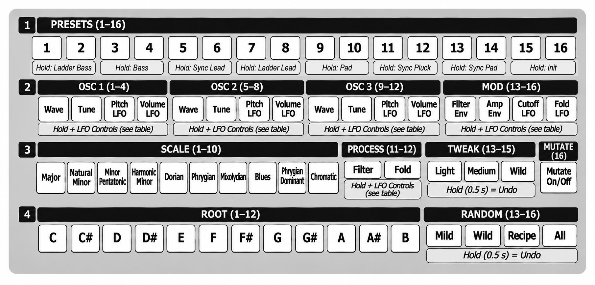

# SYNTH LAB USER GUIDE

**SYNTH LAB** is a monophonic synth voice for the Pērkons, on any of its four voices. It goes
from classic analog synth sounds to mangled, heavily modulated, multi-layered soundscapes.

* **Three oscillators**, each with its own waveform and tuning, and its own LFOs to modulate
  its pitch and its volume separately.
* **16 presets** to start from, and every part of the sound is yours to shape: build your own
  sounds exactly the way you want them, and save them with the kit.
* **Random** makes new sounds from the preset's character, and **Tweak** nudges the sound
  that's playing, a little or a lot.
* **Scale and root**: TUNE plays only the notes of the key you set.
* **Hard sync with filter sweeps**: the classic sync scream, swept on every note.

**Tip: Random is the quickest way to experiment.** It builds each new sound from the preset
you chose, so it keeps that preset's character. For the most interesting results, pick a
preset you like and press **Random Wild** (row 4, step 14) a few times. When one grabs you,
shape it further with **Tweak** (row 3, steps 13-15): a little, more or a lot. Keep a sound
you like by saving the kit; hold a Random or Tweak step to go back one.

SYNTH LAB is a port of Marco Synth, a synthesiser developed for iOS, reworked to get the most
out of the incredible-sounding Pērkons.

Based on official Pērkons firmware **1.3.0**. Unofficial; not affiliated with Erica Synths.

## Getting it

The easiest way is the [Perkons Mod Matrix Desktop](https://github.com/remixed123/modmatrix-desktop#mod-matrix-desktop)
app for macOS and Windows: nothing else to install. Load your own official firmware 1.3.0,
tick **SYNTH LAB** and press **PATCH IT**. You can also run the Mod Matrix from perkons-re: follow
[Get modded firmware](https://github.com/kiteless/perkons-re#get-modded-firmware). No
firmware files are provided here. To remove it, flash the official
firmware again.

voice-synth-lab runs as a voice-map engine: in the Mod Matrix, on the **ENGINES** tab, tick
**ENABLE CUSTOM VOICE ENGINES**, then install SYNTH LAB. It takes the slot you install it in.

## Putting it on a voice

On the voice-map engine page (hold KIT and press MOD), press SYNTH LAB's column in the voice's row; its next
note plays SYNTH LAB. **Hold that step for half a second** to open its
[configuration page](#the-configuration-page) for that voice. The voice's analog filter, DRIVE, FX send
and level stay with the voice; only the sound engine changes.

## Controls

| control | what it does |
|---|---|
| **TUNE** | Picks the note. It steps through the notes of the scale and root set on the configuration page, from C2 to C6. The lowest oscillator plays this note; the others sit at their own intervals above it |
| **DECAY** | Works as **GATE**: how long each note holds before it releases, from 0.05 s to 2 s. From about 95% up, the note never releases: it **drones** |
| **PARAM1** | **Filter cutoff.** At 12 o'clock you hear the sound as saved; turn left to close the filter, right to open it, all the way to 20 kHz. Softer notes play a little darker: velocity closes the filter by up to an octave |
| **PARAM2** | Its job depends on ALGO (below). At 12 o'clock you hear the sound as saved; turn either way from there |
| **ALGO** | Chooses PARAM2's job (positions top to bottom): 1: **resonance** 2: **filter envelope amount** 3: **sync pitch**: moves the synced oscillators from an octave down to two octaves up. The note stays the same; only the sync tone changes |
| **MODE** | **Drive** into the filter, on every sound (positions top to bottom): 1: **clean**: the sound as saved 2: **warm**: rounded, thicker, a touch of grit 3: **hot**: driven hard, gritty and dense The level stays about the same, so it changes the tone, not the volume. It sounds especially good into the [ladder filter](#the-ladder-filter) |
| CUTOFF, filter switch, DRIVE, FX SEND, LEVEL | The Pērkons's analog stages, as on every voice. SYNTH LAB gets a little quieter as DRIVE goes up (+3 dB with no drive, -3 dB at full), so DRIVE changes the tone more than the volume |

* **The filter saturates like an analog one**: push the resonance and it growls rather than
  whistling or clipping, and it stays stable however fast it's swept.
* **PARAM2 keeps all three values.** When ALGO gives it another job, that value stays as it was
  until you move the knob; then the knob sets it.
* **Hard sync and sweep play as the sound sets them**, whatever MODE is on: an oscillator with its
  sync on (Wave cell, SYNC) is hard synced to oscillator 1, and if it has a sweep depth (Tune
  cell, MOD LVL) the filter envelope sweeps it up on every note, the classic sync "yow".

## The configuration page

Each voice playing SYNTH LAB has its own configuration page. To open it:

1. Hold **KIT** and press **MOD** (from any page) to open the voice-map engine page.
2. Find the voice's row and SYNTH LAB's column (the slot you installed it in).
3. **Hold** that step for half a second. The configuration page for that voice opens. If
   the voice wasn't playing SYNTH LAB yet, this also puts it on that voice.

The trigger keys still play the voices while the page is open, so you can hear every change.
Press **SHIFT**, **KIT** or **MOD** to go back to the engine page.

### Cells: editing the sound

Row 2 and steps 11-12 of row 3 are **cells**. Each cell holds four settings, and you edit
them with the Pērkons's LFO controls:

1. **Hold** a cell's step.
2. While holding it, turn **RATE**, **WAVE** or **MOD LVL**, or press **SYNC**.
3. Let go. The LFO controls go back to the Pērkons's own LFO, whose settings haven't changed.

A knob only takes over once you turn it a little, so just holding a cell changes nothing.

| cell | RATE | WAVE | MOD LVL | SYNC (on / off) |
|---|---|---|---|---|
| **Wave** (osc 1-3) | waveform: sine, triangle, saw, ramp, pulse, noise | pulse width (pulse wave) | oscillator volume | hard sync to oscillator 1 (oscillators 2 and 3) |
| **Tune** (osc 1-3) | octave / interval: x0.25, x0.5, x1, x1.5, x2, x3, x4, x8 | fine tune, ±50 cents | sweep depth: how far the filter envelope sweeps a synced oscillator up on each note, up to 4 octaves (0: no sweep) | sync detune: nudges whole-number ratios off, so the sync tone stays bright instead of just doubling oscillator 1 |
| **Pitch LFO**, **Volume LFO** (osc 1-3), **Cutoff LFO**, **Fold LFO** | speed, 0.05 to 20 Hz (a note division when synced) | shape: sine, triangle, saw, ramp, square, random | depth | follow the Pērkons's tempo |
| **Filter Env**, **Amp Env** | attack time | release time | sustain level | curve: linear (off) or exponential (on) |
| **Filter** (row 3, step 11) | type: low-pass 6, 12, 18 or 24 dB, band-pass, high-pass, notch, [ladder](#the-ladder-filter) | key tracking: how much the cutoff follows the note (4 steps) | filter envelope decay time | filter on / off |
| **Fold** (row 3, step 12) | fold amount | symmetry: shifts the fold for a different set of harmonics | envelope push: how much the filter envelope adds to the fold on each note | wavefolder on / off |

### The ladder filter

The last filter type, at the top of the Filter cell's RATE, is a **ladder**: a model of the
classic transistor-ladder low-pass found on the great analog monosynths, the sound of fat basses
and acid lines. Like LP24 it cuts 24 dB per octave, but it behaves differently:

* **Resonance thins the bass.** As you turn the resonance up, the ladder trades low end for a
  round, vocal peak: the squelch of an acid line. LP24 keeps its low end at any resonance.
* **It saturates as a whole.** Push the resonance or play loud sounds into it and it thickens
  and growls instead of getting brighter.
* **At full resonance it rings** at the cutoff with a pure tone you can play with PARAM1 and the
  filter envelope.

Presets 1, 2, 3 and 8 use it. Try it on any bass or lead: hold the Filter cell and turn RATE fully up.

### Presets and starters (row 1)

**Press** a preset step to load that preset. Even on the preset already chosen, a press loads
its whole sound again and sets PARAM1 to 12 o'clock; the scale, root and Mutate stay.

The **hard sync** presets also sweep their synced oscillators with the filter envelope on every
note. MODE adds drive to any of them.

| step | preset | filter, sync | the sound |
|---|---|---|---|
| 1 | **Fat Analog Bass** | ladder, no sync | A saw with a saw and a pulse an octave below: thick and round, with a punchy filter envelope and glide between tied notes |
| 2 | **Acid Square** | ladder, no sync | One square wave through a resonant filter with a strong envelope, no sustain and glide between tied notes: the classic acid line |
| 3 | **Dark Bite Bass** | ladder, no sync | A saw over a sine sub. The filter envelope runs backwards: each note starts dark and opens up, a growling bite |
| 4 | **West Coast Bongo** | LP6, no sync | Sines and a triangle through the wavefolder, slowly moved by its LFO: a woody, percussive tone with no sustain |
| 5 | **Aggressive Sync** | LP12, hard sync | Oscillators 2 (saw, an octave up) and 3 (pulse, two octaves up) synced to oscillator 1: a bright, biting sustained lead |
| 6 | **Hoover** | LP12, no sync | Three saws detuned wide, one an octave down, each with its own tremolo: the moving rave hoover |
| 7 | **Synced Vibrato Lead** | LP24, hard sync | A saw and a pulse synced to the master, vibrato on all three and glide between tied notes: a singing lead |
| 8 | **Tearing Lead** | ladder, hard sync | Sync stacked an octave and two octaves up, then the wavefolder: a raw, tearing lead, rounded by the ladder |
| 9 | **Chorus Pad** | LP12, no sync | Two pulse waves slightly detuned, beating like a chorus, with a slow attack and release |
| 10 | **Classic Analog Pad** | LP24, no sync | Three saws detuned, one an octave down, with a slow attack and a slowly breathing filter |
| 11 | **Ethereal Shimmer** | LP12, no sync | A triangle, a sine and a triangle one, two and three octaves up, each fading in and out on its own slow LFO: high and glassy, long attack and release |
| 12 | **Sync Pluck** | LP12, hard sync | A synced saw and triangle with no sustain, the filter and a light fold moved by fast LFOs that restart on every note: a twangy pluck |
| 13 | **Sync Siren** | LP24, hard sync | The synced saw's pitch swept up and down by its LFO, a wailing siren of sync tone over vibrato and a pulse an octave below |
| 14 | **Polyrhythm** | LP12, no sync | Three oscillators each gated by its own LFO at 2, 3 and 5 Hz: one held note plays a rhythm |
| 15 | **Voltage Drift** | LP24, hard sync | A triangle master with two synced saws, the highest slowly drifting in pitch, and the fold breathing in and out |
| 16 | **Crosscurrent** | LP24, hard sync | One synced saw sweeps slowly while the other zaps fast, over a triangle with vibrato and glide between tied notes |

**Hold** a preset step for half a second to load a **starter** instead: a plain sound to build
your own from. Each pair of steps has its own, of the same kind as the presets above it, and the
page shows its name under the pair:

| hold step | starter | filter, sync | what you get |
|---|---|---|---|
| 1-2 | **Init Ladder Bass** | ladder, no sync | a saw with a square sub an octave below, through the ladder with a short filter envelope |
| 3-4 | **Init Bass** | LP24, no sync | the same bass through the 24 dB low-pass: compare the two filters |
| 5-6 | **Init Sync Lead** | LP12, hard sync | a saw with a second saw an octave up, synced, an open filter and a touch of glide |
| 7-8 | **Init Ladder Lead** | ladder, hard sync | the same sync lead through the ladder: rounder and warmer |
| 9-10 | **Init Pad** | LP12, no sync | three slightly detuned saws, slow attack and release, a half-open filter |
| 11-12 | **Init Sync Pluck** | LP12, hard sync | a saw with a synced second oscillator, a short, strong filter envelope and no sustain |
| 13-14 | **Init Sync Pad** | LP24, hard sync | a triangle with a synced saw an octave up, slow attack and release: add a pitch LFO to the saw for a slow sync sweep |
| 15-16 | **Init** | LP12, no sync | a single saw through an open filter: a blank sheet |

As with a preset, the scale, root and Mutate stay as you set them. In every starter the LFOs,
fold and sweep are off, but each LFO already has a useful speed and shape: hold its cell and turn **MOD LVL** to bring in vibrato, tremolo or a filter
wobble. If you hold one by mistake, hold a Tweak or Random step to undo it.

### Random, Tweak, Mutate

* **Random** makes a new sound of the current preset's kind (bass, lead, pad, keys, FX):
  **Mild** stays close to the preset, **Wild** redraws parts of it (waveforms, octaves, sync,
  LFOs, fold), **Recipe** builds a fresh sound from a recipe of that kind, **All** picks one of
  the three. Each press is a new sound; press the preset to go back, or hold a Random step
  to undo the last Random or Tweak.
* **Tweak** moves the sound playing a little (light), more (medium) or a lot (wild); wild can
  also change waveforms, octaves and sync. Presses add up. Hold a Tweak step to undo the last
  Tweak or Random.
* **Mutate** gives every note a small variation of the sound: filter, pulse widths, levels,
  detune, envelopes, fold. Each note varies from the saved sound, so a pattern keeps moving
  without drifting away.

## Saving

Each voice's whole sound is saved with the kit, including Random and Tweak results, the cells,
the scale and root, PARAM2's three values and Mutate. A kit saved before SYNTH LAB was on it
plays the default presets: 1, 5, 12 and 14 on voices 1-4.

## MIDI and the sequencer

* Notes transpose: note 36 means no change.
* Sequenced TUNE values play the scale's notes; sequenced DECAY values give per-step lengths.
* Parameter locks and MIDI CCs on PARAM2 change whatever ALGO gives it when they play.
* Tempo-synced LFOs follow the Pērkons's tempo.
